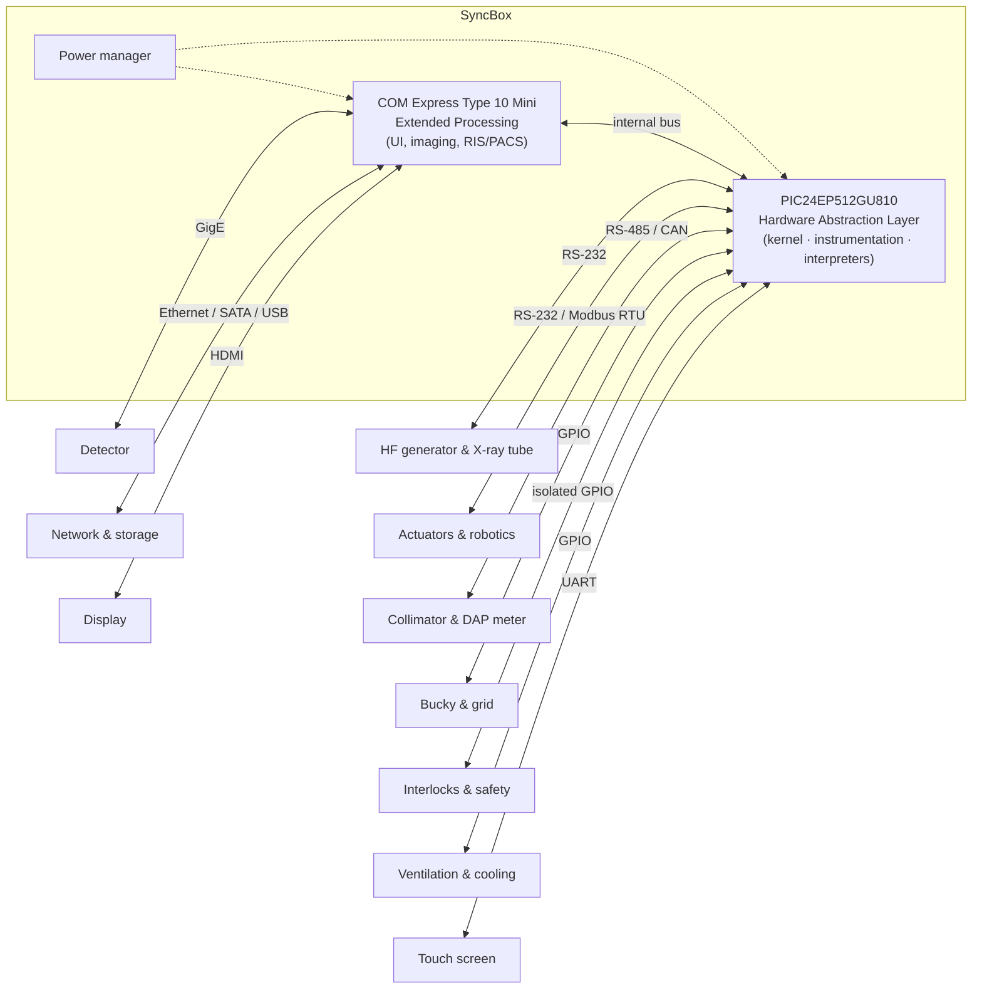

# SyncBox — Unified Open Hardware Platform for Digital X-Ray Devices


**SyncBox** is an open-source hardware platform that sits at the center of a digital X-ray
system. The x-ray tube, high-frequency generator, detector, collimator/DAP meter, bucky & grid,
robotics, cooling, interlocks and network/storage all connect to it. It applies a
**Plug-Integrate-Play (PIP)** design approach to radiography equipment. Researchers and device
builders can pick each component from a different vendor and integrate it through one open,
documented controller instead of a closed OEM design.

This repository contains the full **Altium Designer 20** hardware project (schematics, PCB,
libraries, 3D models), the release/manufacturing outputs, the PIC24 firmware, and supporting
design documentation.

> 📄 SyncBox and its first implementation are described in our peer-reviewed paper in the
> *IEEE Journal of Translational Engineering in Health and Medicine*. If you use this work,
> please [cite it](#citation).

---

## Table of contents

- [Highlights](#highlights)
- [Architecture](#architecture)
- [Board features](#board-features)
- [Screenshots](#screenshots)
- [Repository layout](#repository-layout)
- [Getting started](#getting-started)
- [Versions](#versions)
- [First implementation: TDI full-body scanner](#first-implementation-tdi-full-body-x-ray-scanner)
- [Citation](#citation)
- [Authors & acknowledgements](#authors--acknowledgements)
- [License](#license)

---

## Highlights

- **Central-hub (star) architecture.** Every x-ray subsystem connects to SyncBox, and every
  transaction goes through it. Components do not talk to each other directly.
- **Two-tier hardware:**
  - A **PIC24EP512GU810** 16-bit microcontroller runs the *Hardware Abstraction Layer (HAL)*.
    It handles real-time, safety-critical work: exposure control, emergency/interlock signals,
    sensors and motor drivers. This covers interoperability Levels 1–3.
  - A **COM Express Type 10 Mini** computer-on-module (Intel Celeron, 4 GB RAM) runs the
    *Extended Processing* tier: image acquisition, UI, protocol management, and RIS/PACS
    integration. This covers interoperability Levels 4–5.
- **Medical-grade I/O protection.** All external interfaces pass through a protection and
  isolation layer against ESD, cable discharge events (CDE), EMI and mis-plugging.
- **Vendor-agnostic.** Detector, generator and motion controllers can be swapped by adding an
  *interpreter* for the new device's API. The paper demonstrates switching a TDI line detector
  for a flat-panel detector.

## Architecture



The **HAL** (on the microcontroller) has a small *kernel* that gives each peripheral a
logical **device slot**. Each slot has a buffered send channel, a buffered receive channel and
a direct (unbuffered) channel for emergency messages. The *instrumentation* layer sits on top
of the kernel. It orchestrates the workflow and prioritizes devices and messages. Vendor-specific
*interpreters* translate each peripheral's API into a common language.

The **Extended Processing** layer runs on the COM Express module under a full OS (Linux or
Windows). It handles the UI, protocol preparation, image processing, data management and
RIS/PACS integration.

Full schematics are in [`Release/Schematic Diagrams`](Release/Schematic%20Diagrams).

## Board features

| # | Section | Details |
|---|---------|---------|
| a | RS-485 | Full-duplex |
| b | CAN bus | 3-pin header |
| c | GPIO | Single and paired GPIO |
| d | RS-232 | DSUB-9 (no parity, no handshaking, 8-bit) |
| e | Microcontroller | Microchip **PIC24EP512GU810** (16-bit, 8 MHz crystal → 140 MHz) |
| f | Isolation & protection | Input/output-direction isolation |
| g | Transceivers | Serial-bus connectors |
| h | Transceivers | High-speed connectors |
| i | ICSP | In-circuit serial programming / MCU firmware upgrade |
| j | Computer-on-Module | **COM Express Type 10 Mini** (Intel Celeron, 4 GB RAM) |
| k | Ethernet | Gigabit Ethernet |
| l | USB | USB 2.0 and USB 3.0, connected to the COMe |
| m | HDMI | COMe display output |
| n | GPIO | Connected to the COMe |
| o | Wi-Fi | ESP8266 Wi-Fi module socket |
| p | Touch screen | LCD/touch-screen socket (microcontroller) |
| q | SATA | External hard disk |
| r | Power manager | 12 V input → +5 V and +3.3 V |

In the reference X-ray system, the following devices were connected:

| Device | Type | Protocol | Connection |
|--------|------|----------|------------|
| Teledyne Argus TDI | Detector | Ethernet | GigE RJ-45 |
| Delta ASDA-B2 servo driver | Actuator / robotics | Modbus RTU | RS-232 DSUB-9 |
| Gulmay JA3200 | Power generator | UART | RS-232 DSUB-9 |

## Screenshots

| | |
|:---:|:---:|
|  |  |
| Top view: COM Express module (green), PIC24 MCU, I/O connectors and touch-screen | Isometric view with the LCD/touch panel |
|  |  |
| Close-up of the COMe carrier and serial/USB/HDMI/Ethernet I/O | Full assembly with display |

<p align="center">
  <br>
  <em>Schematic excerpt: ESP8266 Wi-Fi module interface</em>
</p>

## Repository layout

```
syncbox/
├── Design/                 # Working Altium Designer 20 project
│   ├── Syncbox.PrjPcb      #   ← open this project in Altium
│   ├── [01] … [10] *.SchDoc#   hierarchical schematic sheets
│   ├── SYNCBOX.PcbDoc      #   PCB layout
│   ├── SYNCBOX_V3I1.*      #   project schematic/PCB/integrated libraries
│   ├── SYNCBOX_V3I1/       #   library package (SchLib / PcbLib / LibPkg)
│   ├── Syncbox.OutJob      #   output job (Gerber, NC drill, BOM, PDFs)
│   └── Firmware/           #   PIC24 firmware (MikroC PRO), bootloader, LCD firmware, docs
├── Release/                # Frozen release outputs — do not edit
│   ├── Schematic Diagrams/ #   schematics.PDF, schematics_detailed.pdf
│   ├── PCB Manufacturing/  #   Gerber + NC drill outputs
│   ├── 3D/                 #   3D model PDF
│   ├── Board Assembly/
│   └── Firmware/
├── Libs/                   # 3D models (STEP) and shared library parts
├── Templates/              # Altium sheet/project templates
├── Artifacts/              # Datasheets, design guides, errata patches, reports, dev-board material
├── Assets/                 # Screenshots, images and third-party software installers
└── Unified_Open_Hardware_Platform_…pdf   # The SyncBox paper (IEEE JTEHM 2020)
```

## Getting started

### Hardware (Altium)

1. Install **Altium Designer 20** (later versions should also open the project, but it was
   created and tested with AD20).
2. Clone the repository:
   ```bash
   git clone https://github.com/altay-brusan/syncbox.git
   ```
3. Open `Design/Syncbox.PrjPcb`.
4. The project libraries (`SYNCBOX_V3I1.SCHLIB`, `.PcbLib`, `.IntLib`) are referenced
   relatively from `Design/`. 3D models are in `Libs/3D models`.
5. To regenerate fabrication files, run `Design/Syncbox.OutJob`. Ready-made Gerber and NC
   drill files for the released board are already in `Release/PCB Manufacturing`.

> **Release policy:** files under `Release/` are frozen outputs. Don't edit them in place.
> Start a new board revision by copying from `Release/` and read the `TODO` notes in `Design/`.

### Firmware

The microcontroller firmware is in `Design/Firmware/PIC24 Firmware`. It is written for
**MikroC PRO for PIC (v7)**. A packaged copy of the released firmware is in
`Release/Firmware`. Floating-point values use IEEE 754 32-bit format, and integers are 2-byte
little-endian on the wire.

## Versions

| Tag | Description |
|-----|-------------|
| `V1.1` | First release |
| `V2.1` | Second board revision |
| `V3.1` | Third board revision (current release) |

Commits after `V3.1` contain later schematic updates to the microcontroller and CPU-USB sheets
and the `SYNCBOX_V3I1` library package.

## First implementation: TDI full-body X-ray scanner

SyncBox was used to build and run a full-body, high-resolution radiographic scanner at the
X-Lab, Boğaziçi University. The scanner uses a novel **Time-Delay-Integration (TDI)**
detector. The scanner includes:

- **Detector:** Teledyne TDI line detector, 166 lines/cm, about 27 µm resolution
- **Generator / tube:** Gulmay high-frequency generator and X-ray tube
- **Motion:** Delta ASDA-B2 servo controllers, 20 µm step accuracy, up to 10 cm/s

In the paper's results:
- Servo control showed a linear, smooth speed response.
- The TDI detector was swapped for a Toshiba FDX4343R flat-panel detector with minimal effort.
- A full-body scan took about 18 s at about 0.76 mGy.

See the paper for the complete evaluation.

## Citation

If you use SyncBox, its design files, or its concepts in your research or product, **please
cite our paper**:

> F. A. Durmaz, A. Brusan and C. Ozturk, "Unified Open Hardware Platform for Digital X-Ray
> Devices; its Conceptual Model and First Implementation," in *IEEE Journal of Translational
> Engineering in Health and Medicine*, vol. 8, pp. 1-11, 2020, Art no. 1800311,
> doi: [10.1109/JTEHM.2020.3000011](https://doi.org/10.1109/JTEHM.2020.3000011).

**BibTeX**

```bibtex
@ARTICLE{Durmaz2020SyncBox,
  author   = {Durmaz, F. Aytac and Brusan, Altay and Ozturk, Cengizhan},
  journal  = {IEEE Journal of Translational Engineering in Health and Medicine},
  title    = {Unified Open Hardware Platform for Digital X-Ray Devices; its Conceptual Model and First Implementation},
  year     = {2020},
  volume   = {8},
  pages    = {1-11},
  note     = {Art no. 1800311},
  doi      = {10.1109/JTEHM.2020.3000011},
  keywords = {Interoperability;X-ray imaging;Standards;Hardware;Medical devices;Safety;Radiography;Medical imaging;open source hardware;plug-integrate-play (PIP) medical device development;x-ray applications;x-ray imaging hardware}
}
```

A copy of the paper is included in this repository:
[`Unified_Open_Hardware_Platform_for_Digital_X-Ray_Devices_its_Conceptual_Model_and_First_Implementation.pdf`](Unified_Open_Hardware_Platform_for_Digital_X-Ray_Devices_its_Conceptual_Model_and_First_Implementation.pdf)
(published under a Creative Commons Attribution 4.0 license).

## Authors & acknowledgements

- **F. Aytac Durmaz**: Institute of Biomedical Engineering, Boğaziçi University; Durmaz Technology; Pievision
- **Altay Brusan**: Institute of Biomedical Engineering, Boğaziçi University; Durmaz Technology
- **Cengizhan Ozturk**: Institute of Biomedical Engineering and Center of Life Sciences and Technologies, Boğaziçi University

This project was supported by **TÜBİTAK** (project numbers 116E738 and 116E879) and
**Boğaziçi University BAP** (project 6003).

## License

SyncBox is published as open-source hardware. This repository does not include a formal license
file yet. If you build on it, please credit the authors and [cite the paper](#citation). The
included paper is published under a
[Creative Commons Attribution 4.0](https://creativecommons.org/licenses/by/4.0/) license.

> ⚠️ **Safety notice:** SyncBox controls ionizing-radiation equipment. This design is provided
> for research and development. It has **not** been certified (e.g. CE / FDA / IEC 60601). Any
> clinical or commercial use needs proper safety engineering, testing and regulatory approval.
